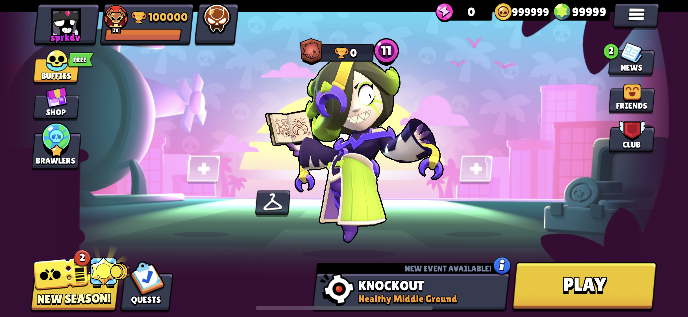

# Offline v70

Offline server for **Brawl Stars v70 on iOS**. It runs inside the game through Frida, so there is no separate server process or IP address to configure.



## What is included

- Local accounts and saved profiles.
- Brawlers, skins, profile icons, and name colors from the client catalog.
- Offline battles with bots, event rotation, Knockout, and Hot Zone.
- Brawl Pass data and local battle results.

The project supports one specific v70 iOS build. The agent checks the game build before installing hooks. **Android is not available yet.** No APK or game assets are included.

## Requirements

- A compatible Brawl Stars v70 iOS client.
- Frida Server 17.x on the device.
- Node.js and Python 3 on the computer.
- A USB connection to the device.

## Run

1. Download this repository and open a terminal in its root directory.
2. Install dependencies:

   ```sh
   npm ci
   python3 -m pip install -r requirements.txt
   ```

3. Build the agent:

   ```sh
   npm run build
   ```

4. Start Frida Server on the device and find the game's bundle ID. If needed, install `frida-tools` to use `frida-ps`:

   ```sh
   frida-ps -Uai
   ```

5. Start the game with the offline agent:

   ```sh
   python3 scripts/run.py --bundle-id YOUR_BUNDLE_ID
   ```

Wait for `[offline-v70] Ready` in the terminal. The launcher closes the game when you press Ctrl+C.

`script.js` is included in the repository for people who only want to run the current build. If you change the source, run `npm run build` again.

## Configuration

`config/config.json` contains the initial offline profile. The game stores account changes in its own Documents directory. Local profiles and device files are excluded from this repository.

Event rotation can be changed in `config/events.json`. The default response delay is 100 ms.

## Development

```sh
npm run check
npm run format:check
npm test
npm run build
```

Source attribution and license details are in [THIRD_PARTY_NOTICES.md](THIRD_PARTY_NOTICES.md).

## Links

- Telegram channel: [bsvschannel](https://t.me/bsvschannel)
- Developer: [sprkdv](https://t.me/niobid)
- Android download: coming later
